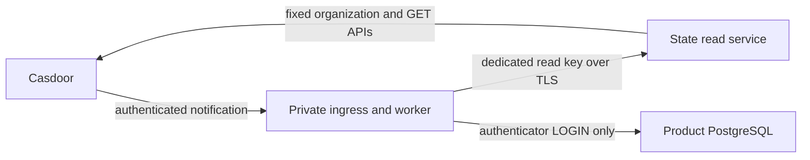

# Casdoor identity state synchronization

Private TLS entrypoints, the read service and the periodic authenticator worker
are implemented. Do not enable them in production until deployment/secret/network
isolation, installed-image admission, lag alerts and complete end-to-end
acceptance are verified.



The read service is the capability boundary. Native Casdoor application
credentials administer their organization; merely giving an application a
different name does not make its credential read-only. The state service holds
that provider credential and exposes only one fixed-subject read endpoint. It
has no product database input. The worker holds a separate read key, never the
provider credential, and cannot select upstream URLs, organizations or APIs.
The normalized response contains a password revision digest but no hash or salt.

## Authority and durable state

`IdentityConnection` remains the canonical link to one stable Global User.
`saas_identity_provider_states` separately records active, disabled or deleted
provider state. Provider deletion is terminal for automatic reconciliation.
Neither notifications nor provider snapshots may restore a locally revoked
connection or a suspended/deleted product user, change credential authority,
create a tenant or grant a product role.

`saas_identity_event_inbox` stores normalized, namespace-bound locator digests,
stable provider event names and processing receipts. It does not store raw audit
objects, credentials, user names or email addresses. Altered reuse of an event
name is rejected. The ingress returns HTTP 200 only after the receipt commits;
the pinned Casdoor Webhook worker does not accept other 2xx statuses as success.

Notifications trigger a fresh fixed-subject read. An event's actor and desired
flags are not the identity authority. An event arriving before its first cache
mapping stays retryable so that a transient security change is not discarded.
Unknown mappings eventually retain a dead-letter receipt for investigation.

## Claims, account locks and sessions

Claims and application lock Global User, canonical connection, then provider
state. The durable claim digest pins the connection, namespace, user security
version, contact snapshot, token and deadline. Provider HTTP requests run outside
these transactions. Application rechecks the full claim and current time after
acquiring locks. An expired worker or a result obtained before an intervening
account/connection change cannot commit.

Confirmed state, contact-verification or password revision changes invalidate
local sessions and advance the existing subject OIDC fence. An old callback
therefore cannot create a valid session after synchronization. The first read
also checks the provider's password-change time. The password revision is a
domain-separated metadata digest that distinguishes same-second resets; no
password hash or salt is retained in the sync tables.

Observed disabled/deleted identities are excluded from login, provision, link,
reauthentication, session issue, verified invitation contact, backup sign-in
methods and credential cutover. A fresh offline-authorized reconnection can
resolve a disabled cache after provider readback, but cannot reactivate a
provider-deleted cache. Recovery alone does not restore the old identity.

Read failures remain operational failures. They do not imply deletion or revoke
otherwise valid sessions. Periodic claims include missing caches and due active
or disabled connections, with intervals/backoff bounded at 60 seconds. Bounded
worker loops interleave periodic and Inbox work; a read failure does not starve
notification intake. Actual deployed workers and admitted load must still prove
the five-minute convergence target.

## Process configuration

Both processes require release product/upstream revisions, source SHA, image
digest and the public `OMNIGENT_SAAS_CASDOOR_CONFIG_FILE` customer application
pins. Installed wheel metadata must match the configured product revision.
Neither process accepts import-marker, credential-recovery, web OIDC or artifact
credentials. The reader and Webhook authentication keys must be independent.

`OMNIGENT_SAAS_IDENTITY_SYNC_CONFIG_FILE` is public, closed-schema JSON:

```json
{
  "schema_version": 1,
  "reader_origin": "https://identity-reader.internal.example.test",
  "reader_key_id": "current",
  "reader_ca_file": null,
  "provider_source_lock_sha256": "REPLACE_WITH_SHA256_OF_BUNDLED_SOURCE_LOCK",
  "concurrency": 4,
  "reconcile_seconds": 60,
  "poll_seconds": 1
}
```

The source-lock value must equal the bundled `source-lock.json` digest. A null
CA file uses platform trust roots; an explicit regular CA file still requires
certificate and hostname verification. Origins cannot contain credentials,
paths, queries or fragments. Production loaders do not permit HTTP.

The read service additionally receives:

| File setting | Contents |
| --- | --- |
| `OMNIGENT_SAAS_IDENTITY_BROKER_PROVIDER_CONFIG_FILE` | `{"schema_version":1,"provider_application":"private-state-reader","provider_client_id":"DEDICATED_ORG_APP_CLIENT_ID","provider_ca_file":null}` |
| `OMNIGENT_SAAS_IDENTITY_BROKER_PROVIDER_SECRET_FILE` | That organization's dedicated provider API secret; never the public web application's secret |
| `OMNIGENT_SAAS_IDENTITY_READER_KEYS_FILE` | `{"schema_version":1,"keys":{"current":"INDEPENDENT_RANDOM_READER_SECRET"}}` |

The dedicated application must belong to the configured customer organization,
be unshared, and permit only `client_credentials`. Disable registration,
self-signup, interactive sign-in, password/guest/auto/code/session/WebAuthn
sign-in, external providers, redirects, backchannel logout and active sign-in
methods. Built-in, public customer and dynamic-registration applications are
rejected. Before every subject read the broker verifies the exact application,
client ID and authenticated unmasked secret, then the organization's password
policy. Anonymous application metadata with a masked secret cannot qualify an
invalid Basic credential or turn a failed credential into a false deletion.

The worker additionally receives the existing credential-worker public role
bindings/graph and sealed migration receipt, plus only
`OMNIGENT_SAAS_AUTHENTICATOR_DATABASE_URL_FILE`. Startup reuses the full source
catalog and role verifier through that exact non-bypass login, without SET ROLE.
Connections have a five-second connect and pool-wait budget, a five-second lock
timeout, a ten-second statement timeout and a fifteen-second idle transaction
timeout. The pool is bounded at `min(concurrency + 2, 8)` with no overflow.
These source-owned settings apply before startup verification; timeout rolls
back the transaction and retains the durable claim for bounded retry.
It also receives:

| File setting | Contents |
| --- | --- |
| `OMNIGENT_SAAS_IDENTITY_READER_SECRET_FILE` | One reader secret matching `reader_key_id`; no provider keyring or provider API secret |
| `OMNIGENT_SAAS_CASDOOR_WEBHOOK_SECRET_FILE` | `{"schema_version":1,"keys":{"current":"DIFFERENT_RANDOM_WEBHOOK_SECRET"}}` |

Both receive `OMNIGENT_SAAS_IDENTITY_TLS_CERT_FILE` and
`OMNIGENT_SAAS_IDENTITY_TLS_KEY_FILE`. Secrets and private keys must be regular,
non-symlink, owner-only files owned by the process user. Certificates and public
configuration must not be writable by other users. Keep input mounts separate;
source-level environment checks do not prove pod filesystem isolation.

Run the pinned image with one of these module commands:

```sh
python -m saas.production.identity_read_broker_main
python -m saas.production.identity_sync_main
```

They serve direct TLS on port 8443. Forwarded headers confer no HTTPS trust;
access logs and WebSockets are disabled. The read service only exposes
`GET /internal/casdoor/identity-state?subject=...` and a health probe. Its private
headers are `X-Omnigent-Identity-Reader-Key-Id` and
`X-Omnigent-Identity-Reader-Secret`. A successful authenticated null provider read
can report a missing user; HTTP failure, redirection, wrong source pins or stale
snapshots cannot. Each request rechecks the provider password policy.

Webhook headers remain `X-Omnigent-Identity-Event-Key-Id` and
`X-Omnigent-Identity-Event-Secret`. Retain overlapping old/new keys through
deployment and the provider's durable retry backlog. Running processes snapshot
their keyrings at startup; changing a file alone does not rotate an active
process. Never reuse Webhook, reader, provider or web OAuth secrets.

## Health and lag

The private worker exposes `/healthz`, `/readyz` and `/metrics`. Readiness checks
its database and worker lifecycle, independently of provider availability, so
IdP read failures do not stop durable notification reception. The public product
runtime does not use these worker probes as its readiness dependency.

Metrics contain aggregate numbers only, without subject, username, email, event
or credential labels:

- `omnigent_identity_sync_reconcile_age_seconds` and
  `omnigent_identity_sync_event_age_seconds`: oldest relevant snapshot/event age.
- `omnigent_identity_sync_unchecked_connections`,
  `omnigent_identity_sync_readback_failed_connections` and
  `omnigent_identity_sync_event_backlog`: current outstanding work.
- `omnigent_identity_sync_dead_events_total`, `..._failures_total`,
  `..._events_total` and `..._reconciled_total`: dead letters and processing counts.
- `omnigent_identity_sync_worker_healthy`: current worker-thread progress, even
  when the metrics HTTP endpoint itself remains reachable.

Missing caches are included in lag; inactive product users, local revocations
and terminal provider deletion are excluded. Install and exercise alerts for
age above 300 seconds, new dead letters, sustained readback failures and missing
worker probes before rollout. Complete the initial baseline before admitting a
cohort. The [alert rules and deployment guidance](../../deployment/identity/README.md#monitoring-and-operations)
and [offline-reviewed dead-letter workflow](IDENTITY_DEAD_LETTERS.md) implement
the operations path; actual installed alert routing, reviewed replay and
matched restore remain release requirements.

## Release and restore requirements

The [identity evidence gate](../identity-evidence/README.md) is a mandatory
foundation and enterprise identity dependency. It requires exact signed
acceptance plus bound live observations; component tests and fixture metadata
cannot qualify it. Stage resources stay disabled until deployment activation
admission and the actual release evidence pass.

- Use a separately authenticated controlled HTTPS ingress, a rotating private
  Header keyring and bounded requests. Forwarded protocol headers and browser
  cookies alone do not authenticate this channel.
- Give the worker only its verified authenticator database login, public IdP
  pins, release receipt and independent state-read capability. Keep the provider
  administration secret in the database-free read service. This isolates the
  worker; it does not claim native Casdoor application credentials lost their
  organization administration authority.
- Render and verify separate secret mounts, powerless ServiceAccounts, direct
  TLS services and default-deny network policies. The worker needs PostgreSQL,
  the read service and DNS; the read service needs only Casdoor and DNS. No
  public product ingress should expose either private process. These deployment
  and monitoring resources still require end-to-end qualification.
  The [identity stage renderer](../../deployment/identity/README.md) supplies
  disabled, release-bound resources and preserves the parent release bytes.
  Its final activation remains blocked pending identity-specific admission.
- Verify the exact serving revision, subject fences, worker source/image and
  paired schema receipt before enabling processing. Follow the credential
  migration runbook's replica-drain requirements for older serving revisions.
- Keep worker availability and lag separate from product runtime readiness.
  Alert on dead letters, readback failure and convergence lag above 300 seconds;
  prove the limit with the admitted identity population and request budgets.
- Include both new tables in the matched product/IdP/key restore. Once either
  table contains records, database downgrade is rejected; use application
  rollback while preserving the expanded schema and receipts.
- Qualify every PostgreSQL 16/18 role profile independently. Never copy a
  predecessor catalog digest or treat a discovery candidate as approval.

## Developer verification

Run from the repository root using the checkout's environment:

```sh
PYTHONPATH=. python -m pytest -q tests/saas/test_identity_sync.py \
  tests/saas/test_identity_sync_credential_fences.py \
  tests/saas/test_identity_inbox.py tests/saas/test_identity_events_http.py
PYTHONPATH=. python -m pytest -q tests/saas/test_identity_process_config.py \
  tests/saas/test_identity_process_composition.py tests/saas/test_identity_read_broker.py \
  tests/saas/test_identity_read_tls.py tests/saas/test_identity_sync_worker.py
```

With `OMNIGENT_SAAS_TEST_POSTGRES_URL` pointing to a disposable test cluster, run:

```sh
PYTHONPATH=. python -m pytest -q tests/saas/test_identity_sync_postgresql.py \
  tests/saas/test_identity_sync_migration.py tests/saas/test_identity_sync_worker_postgresql.py
```

Repeat the PostgreSQL tests on both supported majors. They use isolated
databases and independent NOBYPASSRLS authenticator logins. Human acceptance
must additionally sign in through real OIDC, mutate the same owned IdP account,
observe old sessions fail within five minutes, then verify a permitted fresh
sign-in and unchanged workspace roles. Local test assertions and fixture-driven
ticks do not replace that complete ingress/worker/browser acceptance.
